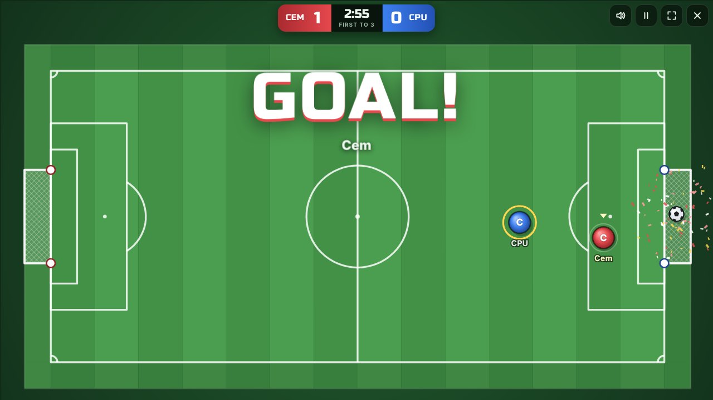

# ⚽ Kickabout

Fast, top-down football you can play **online with a friend**, right in the browser.
No accounts, no installs, no game server: one of you creates a room, sends the link, and you're playing.



- **Online multiplayer:** 1 v 1 up to 4 v 4. Share a link or a 5-letter room code. Connects directly between browsers where it can, and through a relay where networks don't allow that.
- **CPU players:** fill out the teams online (play together against the computer), or practise solo on Easy, Normal or Hard.
- **Same keyboard:** two players on one computer.
- **Phones and tablets:** on-screen joystick with kick and sprint buttons. Gamepads work too.
- Kick-offs, golden-goal overtime, own goals, a stamina-limited sprint, synthesised sound effects, and confetti.

## Play with your friend

1. Open the game (see [Put it online](#put-it-online-github-pages) for your own link).
2. Type your name and press **Create a room**.
3. Press **Copy invite link** and send it to your friend (WhatsApp, Discord, anything).
4. When their name appears in the lobby, pick the match length and press **Start match**.

Your friend can also type the room code into **Join** on the main menu.
Keep the game open while you play: the host's browser runs the match.

## Controls

|                   | Move           | Kick          | Sprint        |
| ----------------- | -------------- | ------------- | ------------- |
| Online / practice | WASD or arrows | Space or X    | Shift         |
| Local player 1    | WASD           | Space         | Left Shift    |
| Local player 2    | Arrows         | Enter / Num 0 | Right Shift   |
| Gamepad           | Stick or D-pad | A / X         | B / RB / RT   |
| Touch             | Left thumb     | KICK button   | SPRINT button |

**P** or **Esc** pauses (for everyone), **M** mutes.

## How to play

- **Hold kick before you reach the ball.** Your player gets a white outline when a kick is ready, and the ball flies the moment you touch it. To kick again, release the button and press it again.
- Just running into the ball dribbles it. You move a little slower while holding kick.
- **Sprint** is quick but drains the yellow stamina ring. Run it dry and you have to wait for it to recover.
- At **kick-off** everyone stays in their own half, and the defending team has to wait outside the centre circle until the ball is played.
- The ball bounces off the walls, so there are no throw-ins or corners. Use the walls.
- If the clock runs out on a draw, it's **golden goal**: next goal wins.

## Put it online (GitHub Pages)

The game is plain static files, so GitHub Pages can host it for free:

1. Go to the repository's **Settings → Pages**.
2. Under **Build and deployment**, choose **Deploy from a branch**.
3. Pick the branch with the game (for example `main`) and the **/ (root)** folder, then press **Save**.
4. After a minute it's live at `https://<your-user>.github.io/football-game/`. Share that link.

Any other static host (Netlify, Cloudflare Pages, Vercel, …) works the same way: upload the folder as-is.

## Run it on your computer

You need [Node.js](https://nodejs.org/) 18 or newer:

```sh
npm start
```

Then open <http://localhost:8080>. It also prints a `http://192.168.x.x:8080` address that other devices on your Wi-Fi can open.
Any static file server works too (for example `python3 -m http.server`). Opening `index.html` directly from disk does **not** work, because browsers block JavaScript modules on `file://` URLs.

## How online play works

- Players first try to connect **directly browser-to-browser** with WebRTC data channels, using [PeerJS](https://peerjs.com/). The free public PeerJS server only does the introduction (matchmaking by room code).
- Many home and mobile connections block direct links between browsers. This is common with carrier-grade NAT, where an internet provider shares one public IP address between many customers, and with strict firewalls. If a direct connection doesn't open within about 7 seconds, the game automatically switches to the **relay**: messages go through free public [MQTT](https://mqtt.org/) brokers over secure WebSockets, which get through almost any network. The host listens on both paths, so nobody has to choose.
- The **host's browser is the referee**: it runs the physics at 60 ticks per second. Guests send their controls and draw the snapshots the host streams back, smoothed with a small interpolation buffer.
- The top-right corner shows your round-trip time to the host, with "relay" added when you're relayed. A relayed connection works the same way but adds some lag, so if one friend's network allows direct connections, let them host.
- Relayed traffic (player names, positions) passes through public brokers that anyone could listen to. It's fine for a kickabout, but don't put anything private in your name.

### Connection options

Add these to the page URL. Invite links carry them over to your friends automatically.

| Option                       | What it does                                                                         |
| ---------------------------- | ------------------------------------------------------------------------------------ |
| `?direct=off`                | Skip the direct attempt and always use the relay (joins faster on blocked networks). |
| `?relay=off`                 | Never use the relay.                                                                 |
| `?relay=wss://host/path,…`   | Use your own MQTT-over-WebSocket broker(s) for the relay.                            |
| `?signal=host:port&secure=0` | Use your own PeerJS signalling server (`npm install && npm run signal`).             |

## Troubleshooting

| Problem                           | Try this                                                                                                                           |
| --------------------------------- | ---------------------------------------------------------------------------------------------------------------------------------- |
| "Room wasn't found"               | The code is case-insensitive but must match. The host must still have the game open.                                               |
| "Couldn't reach the host"         | The host must keep the game open **and on screen**: phones pause web pages in the background (for example while sharing the link). |
| "Couldn't reach the game servers" | Check your internet connection. Some school or office networks block game traffic; try mobile data.                                |
| Joining says it's using the relay | That's expected on some networks and works fine. Add `?direct=off` to skip the 7-second direct attempt.                            |
| Laggy                             | Let the player whose ping doesn't say "relay" host. Close big downloads or streams.                                                |
| No sound                          | Click or press a key once. Browsers only allow sound after you interact with the page. Check that **M** hasn't muted it.           |

## Development

```
index.html, css/       page and styles
js/engine/             pure game logic (also runs in Node)
  constants.js         pitch size and physics tuning
  match.js             physics, kick-offs, goals, clock
  bot.js               computer players
  snapshot.js          compact network snapshots and interpolation
js/client/             browser-only code
  sim.js               fixed-timestep loop and the guest's jitter buffer
  online.js            room protocol (host and guest)
  net.js               connections: direct WebRTC first, relay as fallback
  relay.js             relay transport over public MQTT brokers
  mqtt.js              tiny MQTT 3.1.1-over-WebSocket client
  render.js            canvas drawing and effects
  input.js             keyboard, gamepad and touch
  audio.js             WebAudio sound effects
js/main.js             menus, lobby, HUD and the main loop
vendor/peerjs.min.js   PeerJS 1.5.5 (MIT), vendored so the game has no build step
```

Tests:

```sh
npm install
npm test            # engine and relay unit tests (with a local MQTT broker)
npm run test:e2e    # real browsers play online matches: direct, direct blocked → relay, and no matchmaking server
```

The end-to-end test uses Playwright's Chromium (`npx playwright install chromium` if it isn't installed yet).
